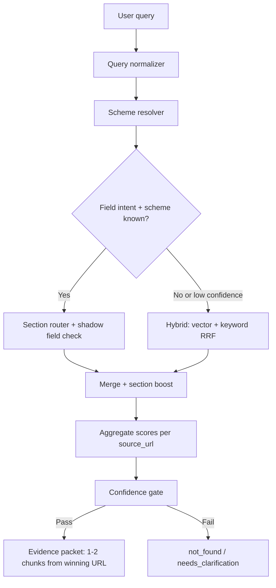
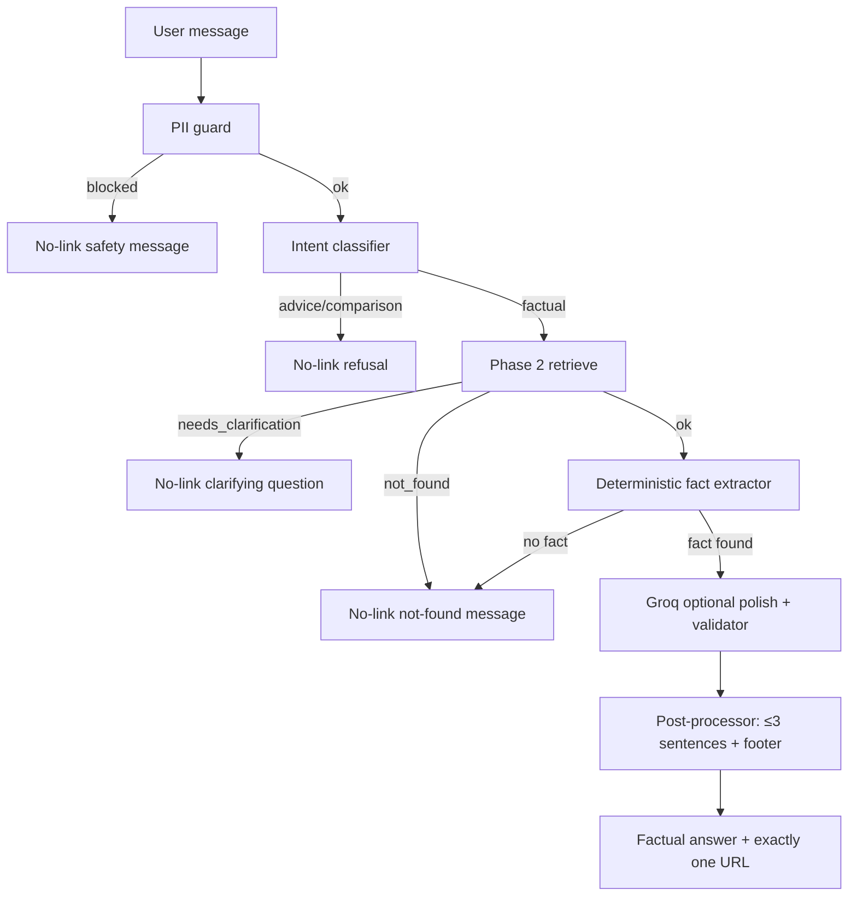

# Phase-wise Architecture: Mutual Fund FAQ Assistant (Facts-Only RAG)

This document provides a **detailed, phase-wise architecture** for the *Mutual Fund FAQ Assistant (Facts-Only Q&A)* described in `Docs/Problem-statment.md`.

---

## High-level system diagram

```mermaid
flowchart TB
  %% User → API
  U[USER<br/>Web UI] --> UI[Minimal UI<br/>Welcome + 3 sample questions + disclaimer banner]
  UI -->|HTTPS| API[API / Orchestrator]

  %% Orchestration core
  subgraph ORCH[API / Orchestrator]
    IG[Input Guard<br/>Block PAN/Aadhaar/account/OTP/email/phone]
    IR[Intent Router<br/>Advice? Comparison? Performance? Process?]
    RET[Retriever<br/>Scheme-first hybrid + field router]
    GEN[Generator<br/>Groq LLM + template fallback]
    POL[Policy Validator<br/>Max 3 sentences + exactly 1 citation]
  end

  API --> IG --> IR

  %% Indexes
  IDX[(Vector + Keyword Index<br/>Chunks + Metadata)]
  RET <--> IDX

  %% Evidence → response
  IR -->|Factual / Process / Performance| RET --> GEN --> POL --> OUT[Answer<br/>Facts-only + 1 source link<br/>Last updated: fetched_at date]
  IR -->|Advice / Comparison| REF[Refusal Response<br/>Facts-only limitation (locked corpus)] --> OUT

  %% Offline ingestion (scheduled)
  GHA[GitHub Actions<br/>cron + manual dispatch]
  GHA --> ING
  subgraph ING[Ingestion Pipeline (Phases 1.1–1.7)]
    SR[Locked Source Registry<br/>Exactly 10 URLs] --> F[Fetcher<br/>Playwright]
    F --> RAW[(Raw Store)]
    RAW --> EXT[Extractor]
    EXT --> NORM[Normalizer]
    NORM --> CHK[Chunker]
    CHK --> EMB[Embedder]
    EMB --> IDXBUILD[Indexer<br/>Chroma + keyword]
    IDXBUILD --> IDX[(Active Index<br/>data/index/active)]
  end

  %% Observability
  OBS[(Observability<br/>privacy-safe logs + metrics)]
  API --> OBS
  RET --> OBS
  POL --> OBS
  REF --> OBS
```

## Phase 0 — Governance & Scope

└── Lock URLs, sources.yaml, refusal taxonomy, PII rules

### Goals
- Establish **facts-only** behavior, refusal rules, and compliance constraints.
- Define **data sources** and the **citation contract** (exactly one link per answer + last-updated footer).

### Key decisions
- **Single-claim answers**: Each response should ideally answer one factual question (or one tight set of related fields like “exit load + conditions”) to keep citations unambiguous.
- **One-citation contract**: Retrieval must produce a *single best source URL* for the final answer (no multi-source merging).
- **Safety & privacy**: Never ask for or store PAN/Aadhaar/account/OTP/email/phone; redact if user provides.

### Locked corpus (exact URLs)
The following URLs are the **only allowed sources** for this project (no other URLs may be fetched, indexed, or cited):
- `https://groww.in/mutual-funds/hdfc-silver-etf-fof-direct-growth`
- `https://groww.in/mutual-funds/hdfc-mid-cap-fund-direct-growth`
- `https://groww.in/mutual-funds/hdfc-equity-fund-direct-growth`
- `https://groww.in/mutual-funds/hdfc-small-cap-fund-direct-growth`
- `https://groww.in/mutual-funds/hdfc-defence-fund-direct-growth`
- `https://groww.in/mutual-funds/hdfc-gold-etf-fund-of-fund-direct-plan-growth`
- `https://groww.in/mutual-funds/hdfc-nifty-50-index-fund-direct-growth`
- `https://groww.in/mutual-funds/hdfc-balanced-advantage-fund-direct-growth`
- `https://groww.in/mutual-funds/hdfc-multi-cap-fund-direct-growth`
- `https://groww.in/mutual-funds/hdfc-pharma-and-healthcare-fund-direct-growth`

Note: This differs from the original “official sources only (AMC/AMFI/SEBI)” constraint—**Groww is a third-party site**—but this project is explicitly locked to the above list.

### Required artifact: `sources.yaml` (lock + metadata)
Maintain the locked list in a single file so ingestion, retrieval, and citation selection all share the same source of truth.

Suggested fields:
- `sources[]`:
  - `id` (stable key, e.g., `hdfc_mid_cap_direct_growth`)
  - `url` (exact URL)
  - `scheme_name`
  - `tags` (e.g., `equity`, `index`, `commodity`)
  - `enabled` (boolean; must be `true` only for these 10)
- `canonicalization`:
  - force `https`, strip query/fragment, normalize trailing slash

### Refusal taxonomy (locked corpus)
Because the corpus is locked, refusals must **not** cite external educational links unless those links are added to the locked list.
Recommended refusal categories:
- `advice_request` (recommendations, “should I invest”)
- `comparison_request` (“which is better”)
- `return_projection` (future performance / calculations)
- `out_of_scope` (unrelated to these 10 schemes/pages)

### Outputs
- Response format spec:
  - Max 3 sentences
  - Exactly one citation link
  - Footer: `Last updated from sources: <date>`
- Refusal templates consistent with the locked-corpus rule (either one locked link or no link, depending on your chosen contract).

---

## Phase 1 — Ingestion & Corpus Build

├── 1.1 Fetcher  
├── 1.2 Extractor  
├── 1.3 Cleaner & Normalizer  
├── 1.4 Chunker  
├── 1.5 Embedder  
├── 1.6 Indexer  
└── 1.7 Refresh & Health

### Components
- **Source Registry**
  - Stores exactly the 10 allowed URLs (or reads them from `sources.yaml`) plus metadata:
    - `source_id`, `url`, `scheme_name`, `enabled`, `last_fetched_at`, `checksum`, `status`
- **Fetcher**
  - Downloads HTML/PDF assets from the registry on a schedule or manually.
  - Enforces **exact URL allowlist** (not just domain), including after redirects.
- **Extractor**
  - Extracts main content from HTML (handle SSR/JS-rendered fallbacks).
  - Detects block pages (403/429/captcha) and fails ingestion for that run.
- **Normalizer** *(implemented — 1.3)*
  - Produces `structured_corpus_v1` JSON per scheme:
    - `data/normalized/<scheme_id>/<run_id>/normalized.json`
    - Companion `meta.json` with `shadow_fields`, `must_have_anchors`, `extraction_health`
  - Facts-only sections (FAQ, holdings, return calculator, fund management already excluded)
- **Chunker** *(implemented — 1.4)*
  - Reads `normalized.json`; chunks **by section**, not by arbitrary token windows
  - See **§ 1.4 Chunker** below for input contract, chunk schema, and split rules
- **Embedder** *(implemented — 1.5)*
  - Reads `chunks.jsonl`; embeds enriched chunk text with a **pinned local model**
  - See **§ 1.5 Embedder** below for input contract, model choice, and output schema
- **Indexer** *(implemented — 1.6)*
  - Loads embeddings into ChromaDB vector store + keyword index
  - Staging → active atomic swap under `data/index/`
- **Refresh & Health** *(implemented — 1.7)*
  - **GitHub Actions** runs the full ingestion pipeline on a schedule and on manual trigger
  - Publishes a new active index only when all 10 schemes pass health gates; otherwise keeps last-known-good
  - See **§ 1.7 Refresh & Health** below
- **Document Store (raw + normalized)**
  - Keeps:
    - raw bytes (for traceability)
    - normalized text
    - extraction metadata (timestamp, checksum, content-length)
    - final URL after redirects (must still match allowlist)

### Data flow
1. Locked URLs loaded from `sources.yaml` → Source Registry  
2. Fetcher downloads → Raw Store (`data/raw/<scheme_id>/<run_id>/raw.html`)  
3. Extractor produces `extracted.txt` → Extracted Store (`data/extracted/`)  
4. Normalizer produces `normalized.json` → Normalized Store (`data/normalized/`)  
5. Chunker reads `normalized.json` → Chunk Store (`data/chunks/`)  
6. Embedder reads `chunks.jsonl` → Embedding Store (`data/embeddings/`)  
7. Indexer loads embeddings + `shadow_fields` → Vector + keyword index  
8. Store `fetched_at` from corpus (used for “Last updated” footer)  
9. **GitHub Actions** (§ 1.7) re-runs steps 2–7 on a schedule to refresh corpus and index

### Quality gates
- Exact URL allowlist validation (pre-fetch + post-redirect)
- Duplicate detection via checksum
- Extraction health checks (`extraction_health: ok`, all `must_have_anchors` true)
- Refresh health:
  - alert if any of the 10 sources fails fetch/extract
  - keep last-known-good index if refresh fails

### 1.4 Chunker

**Status:** Implemented (`src/mf_faq_assistant/phase1_ingestion/subphase_1_4_chunker/chunker.py`).  
**Input:** `data/normalized/<scheme_id>/<run_id>/normalized.json` (`format: structured_corpus_v1`).

#### Upstream corpus shape (what 1.4 receives)

Each `normalized.json` is one scheme document with top-level metadata and a `sections[]` array:

```json
{
  "scheme_id": "hdfc_small_cap_fund_direct_growth",
  "scheme_name": "HDFC Small Cap Fund Direct Growth",
  "source_url": "https://groww.in/mutual-funds/hdfc-small-cap-fund-direct-growth",
  "fetched_at": "2026-06-02T14:01:58Z",
  "extractor_version": "1.2.0",
  "extraction_health": "ok",
  "must_have_anchors": {
    "About": true,
    "Fund Details": true,
    "Minimum Investments": true,
    "Exit Load and Tax": true
  },
  "sections": [
    { "name": "Meta Description", "source": "meta_description", "text": "..." },
    { "name": "About", "source": "html_section", "text": "..." },
    { "name": "Fund Details", "source": "html_section", "text": "..." },
    { "name": "Minimum Investments", "source": "html_section", "text": "..." },
    { "name": "Exit Load and Tax", "source": "html_section", "text": "..." }
  ]
}
```

**Section inventory (current corpus):**

| Section | `source` | Typical role | Chunk default |
|---|---|---|---|
| Meta Description | `meta_description` | Scheme summary blurb from `<meta name="description">` | 1 chunk |
| About | `html_section` | Launch date, fund manager, risk, high-level facts | 1 chunk (split only if very long) |
| Fund Details | `html_section` | NAV, AUM, expense ratio, objective, benchmark | **1 atomic chunk** — never split |
| Minimum Investments | `html_section` | Min 1st / 2nd / SIP amounts | **1 atomic chunk** — never split |
| Exit Load and Tax | `html_section` | Current exit load, stamp duty, tax implication (+ dated history) | 1 chunk preferred; sub-split only if needed |

**Not in corpus (already excluded in 1.3):** FAQ blocks, return calculator, holdings, fund management bios, performance rankings, Groww footer.

Companion `meta.json` supplies `shadow_fields` (e.g. `expense_ratio`, `min_sip`, `exit_load`, `benchmark`, `risk`, `lock_in`) for keyword retrieval — attach to every chunk from that scheme run.

#### Chunking rules

1. **Section-first:** Default is **one chunk per section**. Never merge sections (e.g. do not combine Fund Details + Minimum Investments).
2. **Atomic sections:** `Fund Details` and `Minimum Investments` must each remain a single chunk — these answer the most common short factual queries (NAV, expense ratio, min SIP).
3. **Long sections:** `About` and `Exit Load and Tax` may exceed a token budget (~400–1200 chars today). If sub-chunking is required:
   - Split on sentence or dated-entry boundaries (e.g. `08 May 2015 …`)
   - Use small overlap (1–2 sentences) so current exit-load rule is not orphaned from its heading
   - All sub-chunks keep the same `section_name` and `section_source`
4. **Health gate:** Skip or fail a scheme run when `extraction_health != "ok"` or any required `must_have_anchors` entry is `false` (About, Fund Details, Minimum Investments, Exit Load and Tax).
5. **Citation alignment:** Every chunk inherits `source_url` and `fetched_at` from the parent corpus so Phase 2 can select exactly one URL per answer.

#### Chunk record schema (output)

Write `data/chunks/<scheme_id>/<run_id>/chunks.jsonl` — one JSON object per line:

```json
{
  "chunk_id": "hdfc_small_cap_fund_direct_growth:20260602T140158Z:fund_details:0",
  "scheme_id": "hdfc_small_cap_fund_direct_growth",
  "scheme_name": "HDFC Small Cap Fund Direct Growth",
  "source_url": "https://groww.in/mutual-funds/hdfc-small-cap-fund-direct-growth",
  "fetched_at": "2026-06-02T14:01:58Z",
  "run_id": "20260602T140158Z",
  "section_name": "Fund Details",
  "section_source": "html_section",
  "chunk_index": 0,
  "text": "NAV: 01 Jun '26 ₹151.13 Min. for SIP ₹100 Fund size (AUM) ₹38,168.18 Cr Expense ratio 0.73% ...",
  "char_count": 198,
  "shadow_fields": {
    "expense_ratio": "0.73%",
    "min_sip": "100",
    "exit_load": "Exit load of 1% if redeemed within 1 year",
    "benchmark": "BSE 250 SmallCap Total Return Index",
    "risk": "Very High risk"
  }
}
```

`chunk_id` format: `<scheme_id>:<run_id>:<section_slug>:<chunk_index>` where `section_slug` is lowercase with underscores (e.g. `exit_load_and_tax`).

#### Expected scale

- **Per scheme:** ~5–8 chunks (not hundreds) — the normalized corpus is already compact (~2–3 KB plaintext per scheme).
- **Full index:** ~50–80 chunks across all 10 locked URLs.
- **Retrieval implication:** Hybrid search can lean on `section_name` + `shadow_fields` for short field queries (“min SIP”, “exit load”, “expense ratio”) without relying on vector similarity alone.

#### 1.4 quality gates

- All four required anchors present before chunking
- `Fund Details` and `Minimum Investments` chunks exist and are unsplit
- `Exit Load and Tax` chunk includes the **current** rule text (not only historical dated entries)
- No chunk text contains excluded content types (FAQ, holdings, calculator)
- `chunks.jsonl` row count matches expected range for the scheme

### 1.5 Embedder

**Status:** Implemented (`src/mf_faq_assistant/phase1_ingestion/subphase_1_5_embedder/embedder.py`).  
**Input:** `data/chunks/<scheme_id>/<run_id>/chunks.jsonl` (output of § 1.4).

#### Upstream chunk shape (what 1.5 receives)

Each line in `chunks.jsonl` is a self-contained chunk with citation metadata and keyword features:

```json
{
  "chunk_id": "hdfc_small_cap_fund_direct_growth:20260602T140158Z:fund_details:0",
  "scheme_id": "hdfc_small_cap_fund_direct_growth",
  "scheme_name": "HDFC Small Cap Fund Direct Growth",
  "source_url": "https://groww.in/mutual-funds/hdfc-small-cap-fund-direct-growth",
  "fetched_at": "2026-06-02T14:01:58Z",
  "run_id": "20260602T140158Z",
  "section_name": "Fund Details",
  "section_source": "html_section",
  "chunk_index": 0,
  "text": "NAV: 01 Jun '26 ₹151.13 Min. for SIP ₹100 Fund size (AUM) ₹38,168.18 Cr Expense ratio 0.73% ...",
  "char_count": 281,
  "shadow_fields": {
    "expense_ratio": "0.73%",
    "min_sip": "100",
    "exit_load": "Exit load of 1% if redeemed within 1 year",
    "benchmark": "BSE 250 SmallCap Total Return Index",
    "risk": "Very High risk"
  }
}
```

**Corpus scale (measured on current data):**

| Metric | Value |
|---|---|
| Total chunks | **50** (10 schemes × 5 sections) |
| Chars per chunk | 75 – 976 (avg ~430) |
| Sections embedded | Meta Description, About, Fund Details, Minimum Investments, Exit Load and Tax |
| Tokens per chunk | Well under 512 — no truncation needed |

This is a **tiny, fixed-size** embedding job: the full active index is ~50 vectors, not thousands. Re-embed the entire corpus on each refresh (no incremental partial-embedding complexity required at this scale).

#### Default embedding model (pinned)

Store model config in `config/embedding.yaml` and record `embedding_model_id` on every embedding record.

| Setting | Value | Rationale |
|---|---|---|
| `embedding_model_id` | `BAAI/bge-small-en-v1.5` | Local, free, strong on short English factual text; no API key for milestone |
| Library | `sentence-transformers` | Standard local embedding path |
| Dimensions | `384` | Model default |
| Normalize | `true` | Cosine similarity in Phase 1.6 / Phase 2 |

**Why this model fits this corpus:** chunks are short, English, field-heavy (NAV, SIP, expense ratio, exit load, benchmark). Semantic search helps disambiguate intent across 10 schemes; exact field hits are still handled by the keyword/`shadow_fields` path in Phase 1.6 — embeddings complement, not replace, that layer.

Do **not** mix embeddings from different `embedding_model_id` values in one active index.

#### Text to embed

Embed an **enriched string** per chunk so vectors carry scheme + section context (critical when 10 schemes share similar field labels):

```
{scheme_name} | {section_name}: {text}
```

Example:

```
HDFC Small Cap Fund Direct Growth | Fund Details: NAV: 01 Jun '26 ₹151.13 Min. for SIP ₹100 Fund size (AUM) ₹38,168.18 Cr Expense ratio 0.73% ...
```

**Do not embed:**
- `shadow_fields` as a separate vector (stored as keyword features in Phase 1.6)
- Raw HTML, FAQ blocks, or excluded content (already absent from chunks)

**Optional retrieval weighting (Phase 2):** `Meta Description` chunks are marketing-heavy (“Returns & Rankings, Performance”); down-rank or exclude from top-k if they surface over factual sections.

#### Embedding rules

1. **1:1 with chunks:** Exactly one embedding per `chunk_id` in `chunks.jsonl`.
2. **Batch all 50:** Single batch embed per refresh — corpus is small enough to run in one pass.
3. **Propagate metadata:** Copy `scheme_id`, `scheme_name`, `source_url`, `fetched_at`, `section_name`, `shadow_fields` onto the embedding record (used by indexer, not re-fetched from chunks).
4. **Health gate:** Only embed runs where chunk `meta.json` has `status: ok` and `chunk_count` is 5.
5. **Version pinning:** Write `embedding_model_id`, `embedding_dimensions`, and `embedder_version` to batch `meta.json`.

#### Embedding record schema (output)

Write `data/embeddings/<scheme_id>/<run_id>/embeddings.jsonl` — one JSON object per line:

```json
{
  "chunk_id": "hdfc_small_cap_fund_direct_growth:20260602T140158Z:fund_details:0",
  "scheme_id": "hdfc_small_cap_fund_direct_growth",
  "scheme_name": "HDFC Small Cap Fund Direct Growth",
  "source_url": "https://groww.in/mutual-funds/hdfc-small-cap-fund-direct-growth",
  "fetched_at": "2026-06-02T14:01:58Z",
  "run_id": "20260602T140158Z",
  "section_name": "Fund Details",
  "embedded_text": "HDFC Small Cap Fund Direct Growth | Fund Details: NAV: 01 Jun '26 ₹151.13 ...",
  "embedding_model_id": "BAAI/bge-small-en-v1.5",
  "embedding_dimensions": 384,
  "embedding": [0.012, -0.034, "..."],
  "shadow_fields": {
    "expense_ratio": "0.73%",
    "min_sip": "100",
    "exit_load": "Exit load of 1% if redeemed within 1 year",
    "benchmark": "BSE 250 SmallCap Total Return Index",
    "risk": "Very High risk"
  },
  "embedded_at_utc": "2026-06-05T12:00:00Z"
}
```

Companion `meta.json` per scheme run:

```json
{
  "scheme_id": "hdfc_small_cap_fund_direct_growth",
  "run_id": "20260602T140158Z",
  "status": "ok",
  "embedding_count": 5,
  "embedding_model_id": "BAAI/bge-small-en-v1.5",
  "embedding_dimensions": 384,
  "embedder_version": "1.0.0",
  "embedded_at_utc": "2026-06-05T12:00:00Z",
  "source_chunks_path": "data/chunks/hdfc_small_cap_fund_direct_growth/20260602T140158Z/chunks.jsonl"
}
```

#### Expected scale

- **Per scheme:** 5 embeddings  
- **Full corpus:** **50 embeddings** (384-dim vectors ≈ 75 KB float32)  
- **Latency:** Sub-second on CPU for 50 chunks with `bge-small-en-v1.5`  
- **Refresh:** Re-embed all 50 when any scheme is re-fetched; indexer swaps atomically (§ 1.6)

#### 1.5 quality gates

- `embedding_count` equals `chunk_count` (5 per scheme, 50 total)
- All vectors share the same `embedding_model_id` and `embedding_dimensions`
- No null, empty, or zero-length embedding vectors
- Every `chunk_id` in `chunks.jsonl` has a matching embedding record
- `embedded_text` uses the `{scheme_name} | {section_name}: {text}` format
- Embeddings produced only from chunks that passed § 1.4 quality gates

#### Retrieval handoff (Phase 1.6 / Phase 2)

| Query type | Primary path | Example |
|---|---|---|
| Short field lookup | Keyword + `shadow_fields` | “min SIP for HDFC Small Cap” |
| Semantic / paraphrase | Vector on `embedded_text` | “how much to start a monthly investment” |
| Scheme disambiguation | `scheme_name` + `section_name` metadata filter | “expense ratio” without scheme named |

Hybrid retrieval (vector + keyword) is **required** for this corpus — vector alone can miss exact `₹100` / `0.73%` matches; keyword alone can miss paraphrased questions.

### 1.7 Refresh & Health

**Status:** Implemented (`subphase_1_7_refresh_health/refresh.py`, `.github/workflows/refresh_corpus.yml`).  
**Goal:** Keep corpus and active index up to date by re-fetching all 10 locked Groww URLs on a schedule.

#### Scheduler: GitHub Actions

Use **GitHub Actions** as the single scheduler for ingestion refresh (no separate cron server).

| Trigger | Purpose |
|---|---|
| `schedule` (cron) | Automatic refresh (e.g. weekly: Sunday 02:00 UTC) |
| `workflow_dispatch` | Manual on-demand refresh from GitHub UI |
| `push` to `main` (optional) | Run pipeline in CI after ingestion script changes |

**Workflow file:** `.github/workflows/refresh_corpus.yml`

#### Pipeline steps (one job)

Run sequentially with `PYTHONPATH=src` and fail fast on any step:

| Step | Script / command | Phase |
|---|---|---|
| 1 | `pip install -r requirements.txt` + `playwright install chromium` | setup |
| 2 | `python scripts/fetch_sources.py` | 1.1 |
| 3 | `python scripts/extract_and_normalize.py` | 1.2 + 1.3 |
| 4 | `python scripts/chunk_sources.py` | 1.4 |
| 5 | `python scripts/embed_sources.py` | 1.5 |
| 6 | `python scripts/build_index.py` | 1.6 |
| 7 | `python -m unittest discover -s tests -q` | health gate |
| 8 | Upload artifacts / publish index | deploy |

Each run writes a new timestamped folder per scheme under `data/raw/`, then propagates latest runs through `data/normalized/` → `data/chunks/` → `data/embeddings/` → `data/index/active/`.

#### Publish rules (last-known-good)

Aligned with § 1.6 atomic swap and edge-case gates:

1. **All-or-nothing:** Publish new `data/index/active/` only if **10/10** schemes complete fetch → extract → normalize → chunk → embed with `status: ok`.
2. **Indexer swap:** `build_index.py` already builds `staging/` then copies to `active/`; previous active is preserved under `data/index/previous/`.
3. **On failure:** Workflow exits non-zero; **do not** overwrite a previously deployed active index. Runtime/API should continue serving the last-known-good index until the next successful refresh.
4. **Drift checks:** Fail if `extraction_health != ok`, `must_have_anchors` missing, `chunk_count != 5`, or `embedding_count != 50`.

#### Artifacts and deployment

`data/` is gitignored locally. In CI, after a successful run:

| Output | Path | Notes |
|---|---|---|
| Active vector + keyword index | `data/index/active/` | ChromaDB + `keyword_index.json` + `documents.jsonl` |
| Index metadata | `data/index/active/meta.json` | `indexed_at_utc`, `scheme_ids`, model id |
| Optional corpus trace | `data/normalized/`, `data/embeddings/` | For debugging failed runs |

**Recommended CI outputs:**

- Upload `data/index/active/` as a **GitHub Actions artifact** (retention e.g. 30 days) for inspection.
- For production deploy (Phase 4+), download artifact or sync to app host volume on successful runs only.

`fetched_at` from the indexed corpus drives the answer footer: `Last updated from sources: <date>`.

#### Example workflow skeleton

```yaml
name: Refresh corpus

on:
  schedule:
    - cron: "0 2 * * 0"   # weekly, Sunday 02:00 UTC
  workflow_dispatch:

jobs:
  refresh:
    runs-on: ubuntu-latest
    steps:
      - uses: actions/checkout@v4
      - uses: actions/setup-python@v5
        with:
          python-version: "3.12"
      - run: pip install -r requirements.txt
      - run: playwright install chromium
      - run: python scripts/fetch_sources.py
        env:
          PYTHONPATH: src
      - run: python scripts/extract_and_normalize.py
        env:
          PYTHONPATH: src
      - run: python scripts/chunk_sources.py
        env:
          PYTHONPATH: src
      - run: python scripts/embed_sources.py
        env:
          PYTHONPATH: src
      - run: python scripts/build_index.py
        env:
          PYTHONPATH: src
      - run: python -m unittest discover -s tests -q
      - uses: actions/upload-artifact@v4
        with:
          name: mf-faq-index
          path: data/index/active/
```

#### 1.7 quality gates

- Scheduled and manual runs use the **same** locked `config/sources.yaml` allowlist
- No partial publish when any scheme fails
- `data/index/active/meta.json` shows `document_count: 50` and `scheme_count: 10` after success
- Failed workflow leaves `data/index/previous/` intact on the runner; production must not swap to a broken build
- Unit tests pass before artifact upload

#### Observability (Phase 5 hook)

Log per run (in GitHub Actions summary or Phase 5 dashboard):

- schemes refreshed / failed
- `indexed_at_utc`
- duration per phase
- refusal to publish reason (if any)

---

## Phase 2 — Retrieval Layer

└── Query normalizer, scheme resolver, field router, hybrid retriever, confidence gate

**Status:** Implemented (`subphase_2_retrieval_layer/`, `config/retrieval.yaml`, `scripts/retrieve_query.py`).  
**Goal:** Retrieve the best single-source evidence packet from the 50-chunk locked corpus for facts-only answering in Phase 3.

### Strategy: scheme-first, field-aware hybrid retrieval

This corpus is **tiny and structured** (10 schemes × 5 fixed sections). Precision beats recall. The recommended — and implemented — strategy is:

1. **Scheme resolver first** — fuzzy-match the query to one of 10 locked schemes; ask for clarification when a field question has no scheme.
2. **Field-aware routing (primary path)** — for factual field questions, jump directly to the preferred section chunk and validate `shadow_fields`.
3. **Hybrid retrieval (fallback)** — RRF-merge vector + keyword search when routing is uncertain or paraphrased.
4. **URL aggregation** — sum chunk scores per `source_url`; pick one winning URL only.
5. **Rule-based confidence gate** — no cross-encoder reranker at this scale.



### Components
- **Query Normalizer** *(implemented)*
  - Conservative lowercasing, whitespace collapse, MF synonym expansion (`midcap` → `mid cap`, `ter` → `expense ratio`).
  - Keeps raw query copy for logging.
- **Scheme Resolver** *(implemented)*
  - Token overlap + `difflib` fuzzy match against `scheme_name`, `id`, and `tags` from `config/sources.yaml`.
  - Supports explicit `selected_scheme_id` (UI dropdown hook).
  - Returns `needs_clarification` when confidence is low or top candidates are too close.
- **Field Intent Detector** *(implemented)*
  - Reuses `FIELD_ALIASES` from § 1.6 (`expense_ratio`, `min_sip`, `exit_load`, `benchmark`, `risk`, `lock_in`).
  - Extra intents: `tax`, `nav`, `aum`, `manager`.
- **Field Router** *(implemented)*
  - Maps field intent → preferred section:

  | Field intent | Preferred section(s) |
  |---|---|
  | `expense_ratio` | Fund Details |
  | `min_sip` | Minimum Investments → Fund Details |
  | `exit_load`, `tax` | Exit Load and Tax |
  | `benchmark`, `risk`, `nav`, `aum` | Fund Details → About |
  | `manager` | About |

- **Hybrid Retriever** *(implemented)*
  - `CorpusIndex.search_vector()` + `search_keyword()` with weighted **RRF** (`keyword_weight: 0.55`, `vector_weight: 0.45`).
  - Section boost (`1.2×`) for preferred sections; **Meta Description down-ranked** (`0.5×`) for factual queries.
  - When scheme is resolved, filter hits to that scheme’s 5 chunks.
- **Confidence Gate** *(implemented — rule-based, no ML reranker)*
  - Field route pass: target section found + `shadow_fields` or alias text present.
  - Hybrid pass: `vector_score ≥ 0.55` **or** `keyword_score ≥ 2.0`, plus field-evidence check for field-specific queries.
  - Fail → `not_found` or `needs_clarification` (no generation in Phase 3).

### Retrieval rules (locked-corpus + one-citation)
- **Single-source selection**: aggregate chunk scores per `source_url`; select the top URL only.
- **Scheme constraint**: when resolver confidence is high, constrain hits to the resolved scheme; if top URL disagrees, prefer resolved scheme URL.
- **Answerability threshold**:
  - Field question without scheme → `needs_clarification` (do not guess).
  - Low confidence or missing field evidence → `not_found` (Phase 3 attaches **no URL**).
- **No cross-source merge**: evidence packet contains **1–2 chunks from the winning URL only**.

### Config and artifacts

| File | Purpose |
|---|---|
| `config/retrieval.yaml` | Thresholds, RRF weights, section boosts |
| `subphase_2_retrieval_layer/retriever.py` | `retrieve()` orchestrator |
| `scripts/retrieve_query.py` | CLI for manual retrieval testing |

#### `RetrievalResult` shape (Phase 3 handoff)

```json
{
  "status": "ok",
  "scheme_id": "hdfc_small_cap_fund_direct_growth",
  "scheme_name": "HDFC Small Cap Fund Direct Growth",
  "source_url": "https://groww.in/mutual-funds/hdfc-small-cap-fund-direct-growth",
  "fetched_at": "2026-06-02T14:01:58Z",
  "field_intent": "min_sip",
  "retrieval_path": "field_route",
  "confidence": 0.95,
  "evidence_chunks": [
    {
      "chunk_id": "...:minimum_investments:0",
      "section_name": "Minimum Investments",
      "embedded_text": "HDFC Small Cap Fund Direct Growth | Minimum Investments: ...",
      "shadow_fields": {"min_sip": "100"}
    }
  ]
}
```

Statuses: `ok`, `needs_clarification`, `not_found`.

#### Phase 2 quality gates

- Scheme-specific golden queries resolve to the correct allowlisted URL.
- Field lookups route to the correct section (expense → Fund Details, SIP → Minimum Investments).
- Ambiguous field queries without a scheme return `needs_clarification`.
- Every successful result cites exactly one `source_url`.
- Meta Description chunks do not win over factual sections for field queries.

#### What we intentionally skip

| Approach | Reason |
|---|---|
| Cross-encoder reranker | 50 chunks — rule-based section routing is sufficient |
| Pure vector top-1 | Misses exact `₹100` / `0.73%` values |
| Pure keyword | Misses paraphrases |
| Multi-URL evidence merge | Violates one-citation contract |

---

## Phase 3 — Orchestrator & Guardrails

└── PII guard, intent classifier, evidence generator, post-processor, refusal composer

**Status:** Implemented (`subphase_3_orchestrator/`, `config/orchestrator.yaml`, `scripts/chat.py`).  
**Goal:** Turn a user message into a facts-only response with strict link and privacy rules.

### Citation & privacy contract (Contract B — locked)

| Response type | Citation URL | Footer | Notes |
|---|---|---|---|
| **Factual answer** (`status: ok`) | Exactly **one** allowlisted Groww URL | `Last updated from sources: YYYY-MM-DD` | Evidence-only generation |
| **Not found** | **None** | None | No guesswork, no fallback link |
| **Needs clarification** | **None** | None | Ask which scheme; do not guess |
| **Refusal** (advice/comparison/projection) | **None** | None | Polite facts-only limitation |
| **PII blocked** | **None** | None | Warn user; do not echo or log raw PII |

**Privacy rule:** Never attach a URL when the assistant does not have a confident factual answer, and never echo personal information (PAN, Aadhaar, account numbers, OTP, email, phone) in responses or logs.

Configured in `config/refusal_taxonomy.yaml` as `link_policy.mode: contract_b_split` and `config/orchestrator.yaml`.



### Components
- **PII Guard** *(implemented)*
  - Runs **before** retrieval, generation, or logging.
  - Blocks PAN/Aadhaar/account/OTP/email/phone patterns from `phase0_governance.pii`.
  - Returns a safe no-link message; does not store or repeat the sensitive input.
- **Intent Classifier** *(implemented)*
  - Uses `config/refusal_taxonomy.yaml` to detect advice, comparison, and return-projection requests.
  - Factual queries proceed to Phase 2 retrieval.
- **Deterministic fact extractor** *(implemented)*
  - `fact_extractor.py` extracts exact values from `shadow_fields` first, then section text.
  - Field-aware patterns for NAV, AUM, expense ratio, min SIP, manager, tax, etc.
  - If no grounded fact exists → `not_found` (no URL); never deflects to “check source”.
- **Evidence-only Generator** *(implemented — Groq LLM optional)*
  - **Default path:** deterministic extraction returns the fact directly (`provider: template`).
  - **Groq path:** [Groq](https://groq.com/) via `config/llm.yaml` (`llama-3.3-70b-versatile`) may rephrase only if `grounding_validator` confirms the answer is in evidence.
  - Strict system prompt forbids deflection phrases; falls back to extracted fact on validation failure.
  - Set `provider: template` in `config/llm.yaml` to force extraction-only generation (tests/CI).
- **Grounding validator** *(implemented)*
  - Rejects deflection language (“available in fund details”, “please check source”, etc.).
  - Validates numeric and textual facts appear in retrieved evidence before accepting LLM output.
- **Post-processor** *(implemented)*
  - Strips URLs from answer body (citation lives in `citation_url` only).
  - Enforces ≤3 sentences; footer on a separate line for factual answers only.
  - Rejects advisory and deflection language in generated text.
- **Refusal / fallback composer** *(implemented)*
  - `not_found`, `needs_clarification`, refusal categories, and PII block — all **without links**.

### Config and CLI

| File | Purpose |
|---|---|
| `config/orchestrator.yaml` | Sentence limit, config paths, link policy |
| `config/llm.yaml` | Groq model id, temperature, API key env var |
| `subphase_3_orchestrator/orchestrator.py` | `chat()` entry point |
| `subphase_3_orchestrator/groq_generator.py` | Groq chat completions client |
| `scripts/chat.py` | CLI for manual testing |

#### `ChatResponse` shape (Phase 4 handoff)

```json
{
  "answer_text": "The minimum SIP for HDFC Small Cap Fund Direct Growth is ₹100.\nLast updated from sources: 2026-06-02",
  "citation_url": "https://groww.in/mutual-funds/hdfc-small-cap-fund-direct-growth",
  "last_updated_date": "2026-06-02",
  "refusal": false,
  "reason": null
}
```

No-link example:

```json
{
  "answer_text": "I'm sorry, but I wasn't able to find that in the scheme sources I have access to. Please try asking about a specific HDFC fund, or rephrase your question.",
  "citation_url": null,
  "last_updated_date": null,
  "refusal": false,
  "reason": "not_found"
}
```

`reason` values: `null`, `not_found`, `needs_clarification`, `pii_blocked`, `refusal_advice_request`, `refusal_comparison_request`, `refusal_return_projection`.

### LLM configuration (Groq)

| Setting | Value | Notes |
|---|---|---|
| Provider | `groq` | Set `provider: template` to disable API calls |
| Model | `llama-3.3-70b-versatile` | Pinned in `config/llm.yaml` |
| Temperature | `0` | Deterministic factual answers |
| API key | `GROQ_API_KEY` | Never commit; use `.env` locally |

Embeddings remain local (`BAAI/bge-small-en-v1.5` via sentence-transformers). Only **answer generation** uses Groq.

### Important guardrail: prompt-injection resistance
- Treat retrieved text as untrusted evidence, not instructions.
- Groq system prompt enforces facts-only constraints; post-processor validates output.

#### Phase 3 quality gates

- PII in user input → blocked with **no URL** and **no echo** of the sensitive value.
- `not_found` / `needs_clarification` / refusals → **no URL**.
- Factual answers → exactly one allowlisted URL + footer date from `fetched_at`.
- Answer body ≤3 sentences (footer excluded from sentence count).
- No advisory or comparison language in factual outputs.
- **Strict grounding:** answers must be extracted from retrieved evidence only; missing facts → polite not-found message with no citation URL
- **No deflections:** phrases like “check source” or “available in fund details” are rejected at generation and post-processing.
- **Query expansion (retrieval only):** NAV/price/returns synonyms expanded in `query_normalizer.expand_query_for_retrieval()` to improve recall without changing user-facing answers.

---

## Phase 4 — UI

└── FastAPI backend + minimal SPA frontend

**Status:** Implemented (`subphase_4_backend/`, `frontend/`, `config/api.yaml`, `scripts/run_api.py`).

### Backend API *(implemented)*

Run: `python scripts/run_api.py` → http://127.0.0.1:8000 (OpenAPI at `/docs`).

| Method | Path | Purpose |
|---|---|---|
| `GET` | `/health` | Index readiness (`index_ready`, `scheme_count`, `document_count`) |
| `GET` | `/config` | `welcome_message`, `disclaimer`, `example_questions` (3) |
| `GET` | `/schemes` | All 10 locked schemes (`id`, `scheme_name`, `url`, `tags`) |
| `POST` | `/chat` | User message → Phase 3 orchestrator response |

#### `POST /chat` request

```json
{
  "message": "Min SIP for HDFC Small Cap Fund Direct Growth",
  "selected_scheme": "hdfc_small_cap_fund_direct_growth"
}
```

`selected_scheme` is optional; when set, must be a valid id from `GET /schemes`.

#### `POST /chat` response

```json
{
  "answer_text": "The minimum SIP for HDFC Small Cap Fund Direct Growth is ₹100.\nLast updated from sources: 2026-06-02",
  "citation_url": "https://groww.in/mutual-funds/hdfc-small-cap-fund-direct-growth",
  "last_updated_date": "2026-06-02",
  "refusal": false,
  "reason": null
}
```

`reason` values: `null`, `not_found`, `needs_clarification`, `pii_blocked`, `refusal_advice_request`, `refusal_comparison_request`, `refusal_return_projection`.

No-link responses return `citation_url: null` per Phase 3 Contract B.

#### Backend design notes

- **Shared index:** `CorpusIndex` opened once at startup (lifespan), reused per request.
- **CORS:** Enabled for local dev frontends (`localhost:3000`, `localhost:5173`).
- **Errors:** Safe messages only — `503` if index unavailable, `400` for invalid scheme id, `500` for unexpected failures (no stack traces).
- **Config:** `config/api.yaml` — host, port, CORS, welcome/disclaimer/examples.

### Frontend *(implemented)*

Vite SPA in `frontend/` (vanilla JS).

| Feature | Source |
|---|---|
| Welcome message | `GET /config` |
| Disclaimer banner | `GET /config` |
| Three example question chips | `GET /config` → `POST /chat` |
| Scheme dropdown | `GET /schemes` → optional `selected_scheme` |
| Chat thread | `POST /chat` |
| Index status pill | `GET /health` |
| Single citation link | `citation_url` field only (body rendered as plain text) |
| Footer line | `last_updated_date` / parsed from answer text |

**Run modes:**

| Mode | Command | URL |
|---|---|---|
| Dev | `npm run dev` in `frontend/` (API on :8000) | http://localhost:5173 |
| Combined | `npm run build` then `python scripts/run_api.py` | http://127.0.0.1:8000 |

### UX safeguards *(implemented)*
- Send button disabled during in-flight requests (no double-submit).
- If query is ambiguous (“expense ratio?” without scheme), API returns `reason: needs_clarification` with **no URL**; UI highlights clarification styling and scheme dropdown.
- Only `citation_url` is rendered as a link — answer body uses `textContent` (no auto-linking).
- Client-side PII hint before send; server-side PII block remains mandatory.
- API errors show a safe retry message (no stack traces).

---

## Phase 5 — Eval & Observability

└── Test suites, CI gates, structured logs, dashboard

**Status:** Implemented (`phase5_eval_observability/`, `config/eval.yaml`, `config/eval_golden.yaml`, `config/drift.yaml`, `config/observability.yaml`, `scripts/run_eval.py`, `scripts/run_drift_check.py`, `.github/workflows/ci.yml`).

### Components
- **Golden eval suite** *(implemented)*
  - `config/eval_golden.yaml` — hard/soft cases for factual answers, refusals, PII, out-of-scope, unsupported AMC.
  - `scripts/run_eval.py` — runs all cases through `chat()` and writes `data/observability/eval_report.json`.
- **Contract validator** *(implemented)*
  - Factual answers: ≤3 sentences, exactly 1 citation URL, footer present, no URLs in body.
  - No-link responses: no citation URL or footer date.
- **Dataset drift checks** *(implemented)*
  - `scripts/run_drift_check.py` — validates active index meta, required sections, shadow fields, and key labels per scheme.
  - Wired into corpus refresh workflow; blocks publish on drift failure.
- **CI gates** *(implemented)*
  - `.github/workflows/ci.yml` — unit tests + drift check + golden eval on push/PR.
- **Structured logs (privacy-safe)** *(implemented)*
  - `structured_logger.py` — logs message hash (not raw text), intent, scheme, retrieval path/confidence, reason, latency, contract violations.
  - Hooked into Phase 3 `chat()`; output at `data/observability/events.jsonl`.
- **Dashboard** *(implemented)*
  - `GET /metrics` — reason counts, retrieval misses, contract violations, top URLs, latency p50/p95.
  - Snapshot written to `data/observability/metrics.json` after each chat event.

---

## Archived details (kept for reference)

The sections below are retained from the previous version and may overlap with the updated phase grouping above.

## Answer synthesis (facts-only) + citation & formatting (detail)

### Components
- **Evidence Assembler**
  - Collects the top supporting chunks from the selected source URL.
  - Produces a short evidence packet for the generator.
- **Response Generator (Groq LLM)**
  - Constrained prompt to:
    - Use only provided evidence text
    - Produce max 3 sentences
    - Avoid advice/recommendations/opinions
    - Avoid comparisons or returns math
- **Citation Formatter**
  - Ensures **exactly one link** (the selected `source_url`) is attached.
- **Last-Updated Resolver**
  - Uses `fetched_at` of the selected source URL (or latest among its chunks) to render:
    - `Last updated from sources: <date>`
- **Policy Validator (hard gate)**
  - Rejects outputs that violate:
    - >3 sentences
    - missing/extra citations
    - advisory language (heuristics + LLM self-check optional)
  - If invalid: regenerate with stronger constraints or fall back to refusal.

### Output contract
- **Factual answers:** 1–3 sentences, exactly one citation link, footer `Last updated from sources: YYYY-MM-DD`
- **Unknown / refused / PII-blocked:** no citation link, no personal information echoed

---

## Refusal handling (advice/comparison) + educational link (detail)

### Components
- **Advisory Detector**
  - Flags queries like “should I invest”, “best fund”, “better than”, “recommend”.
- **Refusal Composer**
  - Returns:
    - Polite refusal
    - Facts-only limitation reminder
    - Exactly one educational link (AMFI or SEBI)
    - Footer with last-updated date from that educational source (or a static “policy updated” date if you don’t ingest AMFI/SEBI pages)

### Examples of refusal categories
- Investment advice requests
- Fund comparisons
- Return projections / “which gives higher return”

---

## Reference implementation mapping (what to build first)

### MVP (fastest path)
- Locked Source Registry (exactly 10 URLs from `sources.yaml`)
- Fetch + normalize
- Chunk + embed + vector+keyword index
- Retrieve + single-source selection
- Facts-only generator + one-link citation + last-updated footer
- Refusal handling
- Minimal UI

### Next iteration
- Reranker, lexical search
- Stronger policy validator
- Offline evaluation harness + monitoring dashboards

